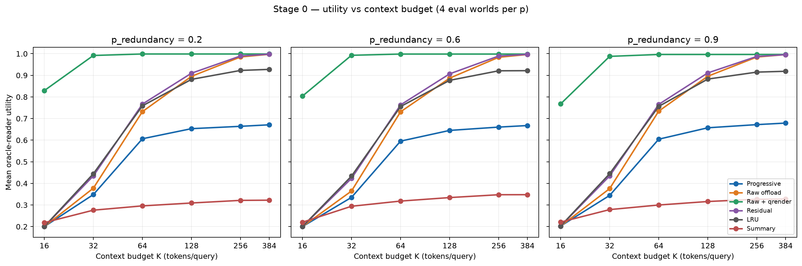
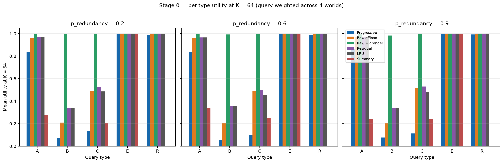

# Aftertrace Stage 0 results — STOP

## Decision

**STOP. Do not start the trained-reader phase.** The v3 symbolic-oracle
frontier produces a literal STOP under the original oracle pre-check: for
each of the three `p_redundancy` levels, all computable best-raw/progressive
K* ratios are below 1.2, with censored cases included conservatively. The
verbatim run decision was:

> `STOP: oracle-reader pre-check (censored K* cases=9; included conservatively)`

The matched-K result independently points the same way: progressive is
substantially worse than the better of raw offload and qrender at every K
and p. The 2026-10-03 fallback amendment was **not triggered**, because best-
raw K* is not censored at every p/target. No reader training or new
experiment was performed for this report.

## Preregistered hypotheses and criteria

| Hypothesis / criterion | Result | Evidence from frozen v3 run |
|---|---|---|
| H1 (primary): progressive beats raw and residual at matched K; 90%-ceiling K* ratio ≥1.5× | **FAIL** | Progressive loses to best raw at every p and K. At K=64, progressive − best raw is −0.3921 [95% bootstrap CI −0.4087, −0.3680] at p=.2; −0.4028 [−0.4043, −0.4012] at p=.6; and −0.3920 [−0.4072, −0.3834] at p=.9. Progressive K* is censored above 384 for every target and p; best-raw K* at target .90 is 22.96, 24.15, and 25.63 respectively. The resulting upper bounds on best-raw/progressive at .90 are <.351, <.378, and <.349, far below 1.5. |
| H2: the progressive advantage grows as K shrinks (K≤64 ratio exceeds K=256) | **FAIL** | There is no positive advantage. Progressive − best raw at K=256 is −.3346, −.3379, −.3245 for p=.2/.6/.9; at K=64 it is worse, −.3921, −.4028, −.3920. |
| H3 (reinstatement): latent-item correctness rises as cue candidate-set size narrows 8→1 without increased confabulation; must also hold for R with `from_superseding=False` | **FAIL / not established** | No R reinstatement advantage appears in the persisted per-type results: at K=64, R utility pooled across p is .9886 for progressive, versus 1.0000 for raw and qrender. Query-level candidate-size/confabulation strata were not persisted in the final aggregate tables, so the specific 8→1 slope and its `from_superseding=False` subgroup cannot be claimed as passed. |
| Reader calibration: full-oracle within .02; between-seed SD <.01; none within .05 of chance; A/B/C calibration | **NOT RUN** | The preregistered oracle pre-check occurs before reader training and stopped Stage 0. No trained-reader calibration was run. |
| Minimum effect of interest: +.03 matched-K utility or 1.5× K* | **FAIL** | Matched-K intervals are strongly negative (table below); all best-raw/progressive K* upper bounds at the .90 target are <.38. |
| Kill condition: raw or residual within CI of progressive at every K | **NOT MET** | Neither is close: at K=64 the best-raw gap is about −.39 to −.40; residual also exceeds progressive at each p. |
| Kill condition: low-K advantage no larger than at K=256 | **MET in direction of kill** | Progressive has no advantage at either budget, and its deficit is larger at K=64 than K=256 for all p (see H2). |
| Kill condition: advantage disappears after second-half demand shift | **NOT EVALUATED** | Final frontier aggregates do not include a preregistered first-half/second-half contrast. |
| Kill condition: summary matches progressive within CI | **NOT MET across the frontier** | Summary does not match progressive across K: for example at K=64, p=.2/.6/.9 utilities are .2959/.3182/.3000, versus progressive .6065/.5956/.6045. |
| Kill condition: confabulation rises with cue diagnosticity | **NOT EVALUATED** | Confabulation-by-candidate-size data were not persisted; H3 is not supported by aggregate R utility, but this slope itself is unmeasured. |
| Scoping: advantage only at p=.9 | **NOT APPLICABLE** | Progressive does not beat best raw at any p. |
| Continue: another weekend, ≥.02 progressive gap at K=32 in right direction | **FAIL** | At K=32 progressive − best raw is −.6435, −.6574, and −.6433 for p=.2/.6/.9. |
| Continue: one-month K* ratio ≥1.5 with CI excluding 1 at both sizes, surviving demand shift | **FAIL / NOT RUN** | Oracle K* bounds are far below threshold; there was no trained-reader size comparison or shift analysis. |
| Continue: cloud/natural-language ratio ≥2 and clean Fig 2 | **NOT RUN** | Outside this Stage 0 synthetic oracle evaluation. |

## Matched-K bootstrap

Paired-world bootstrap of progressive minus the better of `raw_offload` and
`raw_offload_qrender`; 10,000 resamples, four paired eval worlds per p.
Qrender is best raw at every listed point.

| p | K | Progressive | Best raw | Difference | 95% CI |
|---:|---:|---:|---|---:|---:|
| .2 | 384 | .6710 | qrender .9987 | −.3276 | [−.3490, −.3035] |
| .2 | 256 | .6640 | qrender .9987 | −.3346 | [−.3565, −.3103] |
| .2 | 128 | .6532 | qrender .9987 | −.3455 | [−.3655, −.3225] |
| .2 | 64 | .6065 | qrender .9987 | −.3921 | [−.4087, −.3680] |
| .2 | 32 | .3483 | qrender .9918 | −.6435 | [−.6515, −.6371] |
| .2 | 16 | .2001 | qrender .8293 | −.6292 | [−.6325, −.6255] |
| .6 | 384 | .6676 | qrender .9983 | −.3307 | [−.3340, −.3273] |
| .6 | 256 | .6604 | qrender .9983 | −.3379 | [−.3411, −.3347] |
| .6 | 128 | .6451 | qrender .9983 | −.3532 | [−.3555, −.3510] |
| .6 | 64 | .5956 | qrender .9983 | −.4028 | [−.4043, −.4012] |
| .6 | 32 | .3352 | qrender .9927 | −.6574 | [−.6681, −.6513] |
| .6 | 16 | .2001 | qrender .8039 | −.6037 | [−.6110, −.5963] |
| .9 | 384 | .6790 | qrender .9965 | −.3174 | [−.3263, −.3089] |
| .9 | 256 | .6719 | qrender .9965 | −.3245 | [−.3348, −.3136] |
| .9 | 128 | .6572 | qrender .9965 | −.3392 | [−.3498, −.3293] |
| .9 | 64 | .6045 | qrender .9965 | −.3920 | [−.4072, −.3834] |
| .9 | 32 | .3443 | qrender .9877 | −.6433 | [−.6549, −.6349] |
| .9 | 16 | .2025 | qrender .7676 | −.5651 | [−.5724, −.5566] |

## Original oracle pre-check and K*

The comparison uses the run's declared **best-raw / progressive** K* ratio
(larger favors progressive). Progressive K* is censored above 384 at all
three targets (.80, .90, .95) and all p levels. Best-raw K* is uncensored:

| p | Best-raw K* @ .80 | @ .90 | @ .95 | Best-raw/progressive upper bound @ .80 / .90 / .95 |
|---:|---:|---:|---:|---:|
| .2 | 16.00 | 22.96 | 27.88 | <.236 / <.351 / <.537 |
| .6 | 16.00 | 24.15 | 28.38 | <.240 / <.378 / <.551 |
| .9 | 18.36 | 25.63 | 29.26 | <.235 / <.349 / <.537 |

Every computable upper bound is below 1.2, so the original pre-check gives
STOP. The post-v2 matched-K fallback was not invoked because best-raw K* is
not censored at every p/target; its separate criterion therefore does not
replace the original-rule result.

## Instrument history: v1 → v2 → v3

| Run | Instrument changes and observed effect | Recorded decision |
|---|---|---|
| v1 (`runs/oracle_frontier_final`) | Initial symbolic-oracle frontier and utility-tuned policies. Subsequent diagnostics identified incomplete iterative retrieval, qrender being charged by raw rather than rendered size, and non-monotone oracle handling of ambiguous partial evidence. | `REDUCED: oracle-reader pre-check (censored K* cases=15; included conservatively)` |
| v2 (`runs/oracle_frontier_v2`) | Fixed oracle evidence interpretation/monotonicity and conservative SUM handling; deterministic retrieval tie-breaking; tuned policies on the stratified evaluation query mix; applied the original censored-ratio rule literally. Added the matched-K fallback amendment before v3. B still failed because pass 2 often missed the distinct WORKS episode; its raw B utility at K=128/256/384 was only .005–.011 / .021–.028 / .043–.051 across p. | `REDUCED: oracle-reader pre-check (censored K* cases=18; included conservatively)` |
| v3 (`runs/oracle_frontier_v3`) | Corrected two-hop retrieval and charged both passes; B diagnostic improved to 20/20 second-hop episode retrieval at K=384 (targeted 20-query check). Qrender now budgets rendered tokens and retains query-matching facts from pass-2 entities. Added matched-K bootstrap intervals and qrender token efficiency. Raw B utility at K=128/256/384 became .788–.808 / .980–.988 / .984–.993 across p. Best-raw K* was uncensored, so the original rule was decisive. | `STOP: oracle-reader pre-check (censored K* cases=9; included conservatively)` |

The formal label changed from REDUCED to STOP when the instrument corrections
made the original K* comparison computable. The research conclusion never
moved toward proceeding: v1/v2 were explicitly reduced-priority holds, and
v3 concludes STOP. The two-hop correction materially improved B, but did not
rescue progressive; qrender/raw remain near ceiling.

## Per-type result: C is the failure mode; R has no reinstatement gain

At K=64, query-weighted utility across all four worlds at each p, then pooled
over p:

| Condition | A | B | C | E | R |
|---|---:|---:|---:|---:|---:|
| Progressive | .8450 | .0694 | .1164 | 1.0000 | .9886 |
| Raw offload | .9611 | .2075 | .5000 | 1.0000 | 1.0000 |
| Raw + qrender | 1.0000 | .9892 | 1.0000 | 1.0000 | 1.0000 |
| Residual | .9689 | .3461 | .5178 | 1.0000 | .9983 |
| LRU | .9689 | .3461 | .4744 | 1.0000 | 1.0000 |
| Summary | .2864 | .0000 | .2306 | 1.0000 | .0000 |

Type C conflict questions expose the key information-loss problem. At the
same K, progressive C utility is .10–.14 across p, while raw is about .49–.52
and qrender is 1.00: selective query-time rendering keeps the current and
previous conflicting WORKS/MOVED facts needed to answer. R does not show an
incremental reinstatement benefit: raw and qrender are already 1.00 on R at
K=64, and progressive is .989 pooled. At K=64 R utility for progressive is
.9891/.9841/.9931 at p=.2/.6/.9; it does not exceed raw/qrender at any of
those levels.

Qrender averages 3.80–3.82 rendered tokens per item versus 33.91–34.10 raw
L4 tokens per item across p, approximately **8.9× fewer tokens per item**.
The K budget is charged on the rendered context, and only query-relevant
facts are retained (including facts matching entities discovered on pass 2).

## Figures

Both figures summarize the frozen v3 CSVs, four evaluation worlds per p;
they are not new evaluations. `scripts/plot_stage0_results.py` regenerates
them from those saved tables.

## Limitations

- One synthetic world family; results do not establish behavior on natural
  conversations or other data-generating processes.
- Policies are heuristic and the selected rules/parameters are not learned
  end-to-end.
- The reader is symbolic oracle only; no trained-reader result exists.
- Symbolic rendering is charged at zero model-compute cost. Token savings do
  not account for the cost of a model that would perform rendering.
- Bootstrap estimates use only four evaluation worlds per p; intervals are
  paired-world bootstrap uncertainty, not broad population guarantees.
- H3's candidate-set-size/confabulation slope and its non-superseding R
  subgroup are not recoverable from the persisted aggregate result tables.
